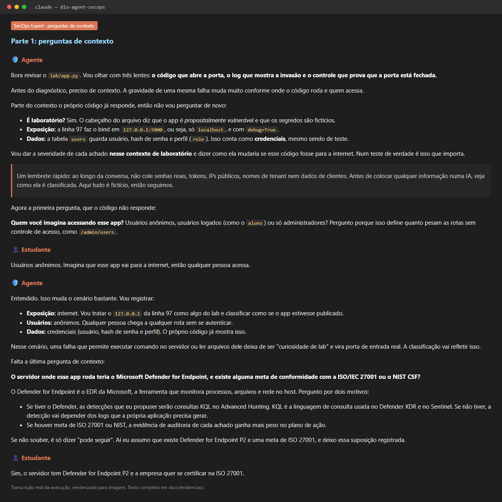
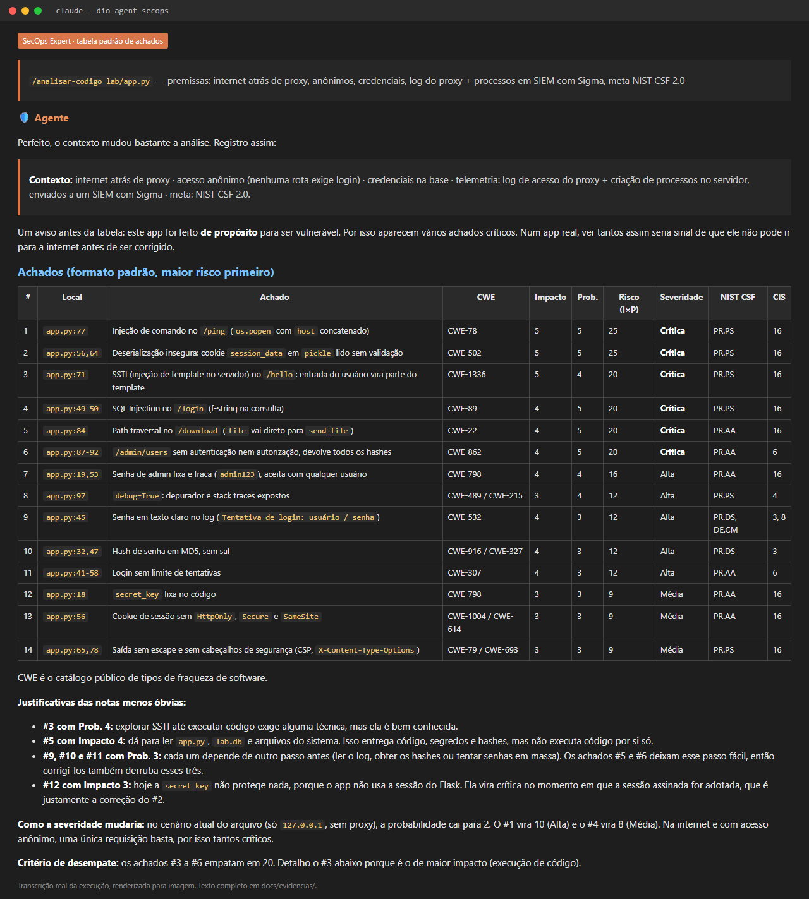
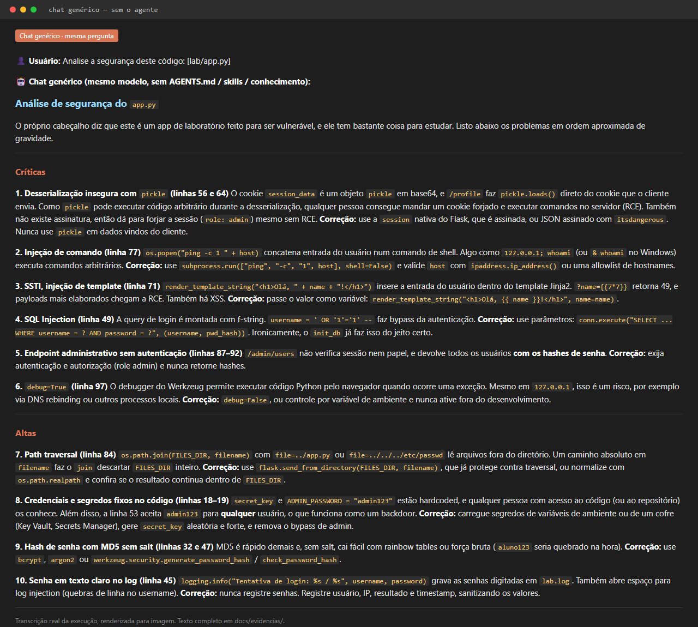
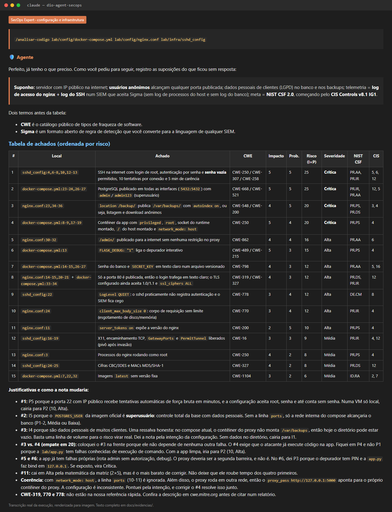

# 🛡️ DIO Agent SecOps Expert

> Uma evolução do [DIO Agent](https://github.com/digitalinnovationone/dio-agent), especializada em **segurança defensiva**: revisão de código e configuração seguros, **testes de segurança**, **detecção com regras Sigma** e **governança com frameworks públicos** (NIST CSF 2.0, NIST SSDF, CIS Controls v8.1, OWASP e MITRE ATT&CK). Neutro em fornecedores.

---

## 🎯 A especialização, e por quê

O DIO Agent original é um mentor de estudos generalista. Esta versão vira um **mentor de Blue Team + governança**, que olha cada problema por três lentes:

| Lente | Pergunta | Referência pública |
|-------|----------|--------------------|
| **AppSec** | Onde o código ou a configuração abre a porta? | OWASP Top 10, CWE, NIST SSDF |
| **Detecção** | Como eu veria o ataque acontecendo? | MITRE ATT&CK, regras **Sigma** (formato aberto, funciona em qualquer SIEM) |
| **Governança** | Qual controle prova que a porta está fechada? | NIST CSF 2.0, CIS Controls v8.1 |

**Por quê:** no mercado essas competências costumam estar separadas. O dev corrige o bug mas não sabe qual controle atende; o analista de monitoramento detecta mas não conversa com a governança; a área de riscos pede evidência mas não sabe gerá-la. Um achado só está completo quando tem **correção + teste + detecção + controle**, e é isso que o agente entrega e ensina.

Um chat genérico responde "isso tem SQL injection". O SecOps Expert **pergunta o contexto primeiro** (exposição, dados, telemetria, meta de adequação), classifica cada achado por **impacto × probabilidade** no mesmo formato sempre e devolve a correção, a regra Sigma e o controle NIST CSF / CIS com a evidência esperada.

**Por que frameworks públicos:** NIST, CIS, OWASP, MITRE e Sigma são gratuitos, abertos e reconhecidos pelo mercado. Qualquer estudante consegue consultar a fonte. A ISO/IEC 27001 aparece só como tabela de equivalência, para quem trabalha numa empresa que já a adota.

---

## 🗂️ O que foi criado ou alterado

### Alterados

| Arquivo | Mudança |
|---------|---------|
| [`AGENTS.md`](AGENTS.md) | Nova identidade (SecOps Expert), base de conhecimento, 5 skills novas na tabela, regras "contexto antes de diagnóstico", "sempre o mesmo formato" e "neutro em fornecedor", e **limites éticos** (só laboratório, sem exploit pronto, sem evasão, sem dados sensíveis). |
| [`agent/persona.md`](agent/persona.md) | Persona de analista sênior de segurança defensiva: evidência, contexto, comparabilidade e defesa ética. |
| [`README.md`](README.md) | Este arquivo. |

### Criados

| Tipo | Arquivo | O que tem |
|------|---------|-----------|
| **Skill** | [`skills/secure-code-review/SKILL.md`](skills/secure-code-review/SKILL.md) | Revisão de código **e de configuração**, com perguntas de contexto, tabela padrão de achados, correção, regra Sigma, plano de ação e **modo alteração** (DevSecOps) com veredito. |
| **Skill** | [`skills/security-testing/SKILL.md`](skills/security-testing/SKILL.md) | Testes que falham enquanto a falha existe e passam depois da correção; SAST, dependências, segredos e configuração no pipeline. |
| **Skill** | [`skills/threat-hunting/SKILL.md`](skills/threat-hunting/SKILL.md) | Hunting guiado por hipótese: ATT&CK, regra Sigma em blocos, validação em laboratório, promoção a regra recorrente. |
| **Skill** | [`skills/compliance-mapping/SKILL.md`](skills/compliance-mapping/SKILL.md) | Mapeamento de risco → NIST CSF + CIS Controls (+ SSDF), visão de avaliador e evidências. |
| **Skill** | [`skills/cyber-study-path/SKILL.md`](skills/cyber-study-path/SKILL.md) | Trilha de estudos em cibersegurança em 4 fases, com especializações ligadas ao NIST CSF e ao NICE Framework. |
| Conhecimento | [`agent/knowledge/risk-scoring.md`](agent/knowledge/risk-scoring.md) | Matriz de impacto × probabilidade (NIST SP 800-30) e a **tabela padrão de achados**. |
| Conhecimento | [`agent/knowledge/nist-csf-ssdf.md`](agent/knowledge/nist-csf-ssdf.md) | NIST CSF 2.0, SSDF, SP 800-30, SP 800-61r3 e NICE Framework. |
| Conhecimento | [`agent/knowledge/frameworks-referencia.md`](agent/knowledge/frameworks-referencia.md) | CIS Controls v8.1, OWASP, MITRE ATT&CK, como escolher o framework e a equivalência com a ISO 27001 (só referência). |
| Conhecimento | [`agent/knowledge/threat-hunting-sigma.md`](agent/knowledge/threat-hunting-sigma.md) | Telemetria, estrutura de regra Sigma, campos por categoria, boas práticas e técnicas ATT&CK. |
| Conhecimento | [`agent/knowledge/cwe-owasp-quickref.md`](agent/knowledge/cwe-owasp-quickref.md) | CWE × OWASP × correção × NIST CSF × CIS, para código **e** para configuração. |
| Laboratório | [`lab/app.py`](lab/app.py) | API Flask **propositalmente vulnerável**, só em `127.0.0.1`, com segredos fictícios. |
| Laboratório | [`lab/config/`](lab/config/) e [`lab/infra/`](lab/infra/) | Cenários novos: containers e proxy reverso inseguros, e um servidor SSH mal configurado. |
| Laboratório | [`lab/tests/`](lab/tests/) | Testes de segurança do `app.py` que falham hoje e passam depois da correção. |
| Laboratório | [`lab/hunting/`](lab/hunting/) | 5 regras **Sigma** que detectam a exploração do `app.py` no log web, nos processos e no acesso a arquivos. |
| DevSecOps | [`devsecops/`](devsecops/) | Hook de pre-commit e portão de segurança genérico para qualquer CI. |
| Melhoria do harness | [`.claude/commands/`](.claude/commands/) e [`.claude/settings.json`](.claude/settings.json) | Ver abaixo. |
| Evidências | [`docs/evidencias/`](docs/evidencias/) | Duas análises reais (código e configuração), comparativo com chat genérico e prints. |

As skills originais do DIO Agent foram mantidas, e o [`CLAUDE.md`](CLAUDE.md) continua importando o `AGENTS.md`.

---

## 🚀 Como rodar no harness

1. Instale um harness compatível com `AGENTS.md` (testado no **Claude Code**; o padrão também é lido por outros harnesses de agentes).
2. Clone o repositório e abra a pasta:

   ```bash
   git clone https://github.com/rafaelcoutinhorc-design/dio-agent-secops.git
   ```

   ```bash
   cd dio-agent-secops
   ```

   ```bash
   claude
   ```

3. Converse naturalmente ou use os comandos:

| Peça | O agente usa |
|------|--------------|
| "Analise a segurança do `lab/app.py`" ou `/analisar-codigo lab/app.py` | `secure-code-review` |
| "Revise a configuração do compose" ou `/analisar-codigo lab/config/docker-compose.yml` | `secure-code-review` |
| "Revise minha alteração antes do merge" ou `/revisar-alteracao main` | `secure-code-review` (modo alteração) |
| "Como provo que corrigi o SQLi?" ou `/testar-seguranca lab/app.py` | `security-testing` |
| "Como detecto command injection num app Python?" ou `/hunt T1059 a partir de python` | `threat-hunting` |
| "Qual controle cobre senha em log?" ou `/mapear-controle senha em log` | `compliance-mapping` |
| "Quero entrar em segurança, por onde começo?" ou `/trilha-cyber AppSec` | `cyber-study-path` |

Rodar o `lab/app.py` e os testes é opcional (a análise é estática). Veja [`lab/README.md`](lab/README.md).

---

## 🔧 A melhoria escolhida no harness

**Comandos de atalho + guardrails de segurança no Claude Code.**

1. **Slash commands** em [`.claude/commands/`](.claude/commands/): `/analisar-codigo`, `/revisar-alteracao`, `/testar-seguranca`, `/hunt`, `/mapear-controle` e `/trilha-cyber` chamam direto a skill certa, com argumento. Isso padroniza a entrada e torna a demonstração reproduzível.
2. **Permissões** em [`.claude/settings.json`](.claude/settings.json), coerentes com a especialização:
   - **deny:** leitura de `.env`, chaves (`*.pem`, `*.key`) e pastas `secrets/`; ferramentas de rede/ataque (`curl`, `wget`, `nmap`, `sqlmap`, `hydra`). O agente de segurança **não consegue** vazar segredo nem atacar alvo externo, mesmo que alguém peça.
   - **ask:** `python` e `pip install` pedem confirmação antes de rodar.

É o princípio do menor privilégio (NIST CSF PR.AA, CIS Controls 5 e 6) aplicado ao próprio agente.

---

## 📐 Formato padrão de achado

Toda análise, de código, configuração ou infraestrutura, sai na mesma tabela, para que os casos possam ser comparados:

| # | Local | Achado | CWE | Impacto | Prob. | Risco (I×P) | Severidade | NIST CSF | CIS |
|---|-------|--------|-----|---------|-------|-------------|------------|----------|-----|

Impacto e probabilidade vão de 1 a 5; o risco é o produto. 17–25 é Crítica, 10–16 Alta, 5–9 Média e 1–4 Baixa. Detalhes em [`risk-scoring.md`](agent/knowledge/risk-scoring.md).

---

## 📸 Evidências

| Evidência | Arquivo |
|-----------|---------|
| Perguntas de contexto que o agente faz | `docs/evidencias/01-perguntas-contexto.png` |
| Análise do `app.py` (tabela padrão de achados) | `docs/evidencias/02-tabela-achados.png` |
| Mesma pergunta num chat genérico | `docs/evidencias/03-chat-generico.png` |
| Análise da configuração e da infraestrutura | `docs/evidencias/04-config-infra.png` |
| Transcrição completa: código | [`docs/evidencias/analise-app-py.md`](docs/evidencias/analise-app-py.md) |
| Transcrição completa: configuração e infraestrutura | [`docs/evidencias/analise-config-infra.md`](docs/evidencias/analise-config-infra.md) |
| Resposta completa do chat genérico | [`docs/evidencias/resposta-chat-generico.md`](docs/evidencias/resposta-chat-generico.md) |
| Comparativo Expert × chat genérico | [`docs/evidencias/comparativo-chat-generico.md`](docs/evidencias/comparativo-chat-generico.md) |






---

## 🧭 Próximos passos

- Rodar os testes de `lab/tests/` e o `devsecops/security-gate.sh` num ambiente com Python e as ferramentas instaladas, registrando o antes e o depois da correção.
- Validar as regras Sigma convertidas num SIEM de código aberto de laboratório.
- Adicionar um cenário de nuvem (armazenamento público, permissões amplas) usando só conceitos neutros.

---

## ⚖️ Ética e escopo

- Todos os testes usam **apenas código e servidor próprios, de laboratório** (`lab/app.py` em `127.0.0.1`). Os arquivos de `lab/config/` e `lab/infra/` são só para análise e não devem ser aplicados em servidores.
- Nenhum segredo, IP, nome de host ou dado real está no repositório; as credenciais são fictícias.
- O projeto é **neutro em fornecedores**: ensina com padrões abertos e ferramentas de código aberto.
- O conteúdo gerado pelo agente é recomendação: decisões de risco e de adequação são humanas.

---

## 🗂️ Estrutura

```
dio-agent-secops/
├── AGENTS.md                 Definição do agente (alterado)
├── CLAUDE.md                 Atalho para o Claude Code
├── .claude/
│   ├── commands/             /analisar-codigo, /revisar-alteracao, /testar-seguranca,
│   │                         /hunt, /mapear-controle, /trilha-cyber
│   └── settings.json         Guardrails de permissão
├── agent/
│   ├── persona.md            Persona SecOps (alterado)
│   └── knowledge/            NIST, CIS/OWASP/ATT&CK, Sigma, CWE, matriz de risco + base DIO
├── skills/                   5 skills novas + skills originais
├── lab/
│   ├── app.py                App vulnerável de laboratório
│   ├── config/  infra/       Configuração e infraestrutura inseguras
│   ├── tests/                Testes de segurança
│   └── hunting/              Regras Sigma
├── devsecops/                Pre-commit e portão de segurança para CI
└── docs/
    ├── evidencias/           Prints, análises e comparativo
    ├── glossary.md
    └── youcom-mcp.md
```

Baseado em [digitalinnovationone/dio-agent](https://github.com/digitalinnovationone/dio-agent).
